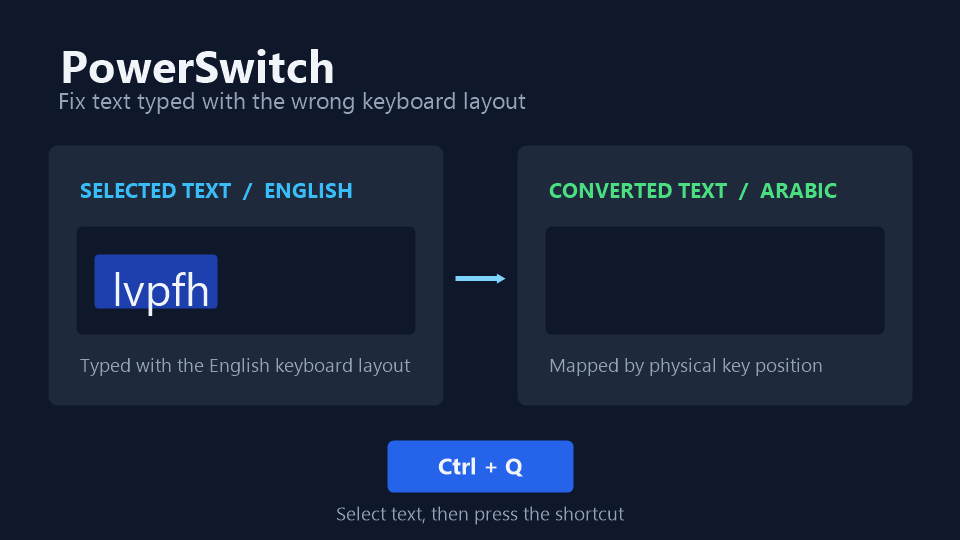

# PowerSwitch

**Fix text typed with the wrong keyboard layout.**

PowerSwitch is a Windows system-tray utility that converts selected text between supported keyboard layouts by matching physical key positions. For example, it can turn text typed with the English layout into Arabic text, or the reverse.

**إصلاح النص المكتوب بتخطيط لوحة مفاتيح خاطئ.**

PowerSwitch أداة لنظام Windows تعمل من شريط المهام، وتحول النص المحدد بين تخطيطات لوحة المفاتيح المدعومة اعتمادًا على مواضع المفاتيح الفعلية. مثلًا، يمكنها تحويل نص كُتب بتخطيط الإنجليزية إلى العربية أو العكس.

> PowerSwitch is an independent project. It is not an official Microsoft PowerToys module.
>
> PowerSwitch مشروع مستقل وليس وحدة رسمية من Microsoft PowerToys.

## Demo



## المميزات باختصار

- تحويل النص المحدد بالاختصار `Ctrl+Q`.
- التحويل حسب موضع المفتاح على لوحة المفاتيح، وليس عبر قاموس.
- دعم تخطيطات الإنجليزية والعربية، مع خرائط احتياطية للإنجليزية الأمريكية والبريطانية، والعربية 101/102، والفرنسية AZERTY، والإسبانية.
- إبقاء الأحرف غير المدعومة كما هي والإبلاغ عنها ضمن نتيجة التحويل.
- العمل من منطقة الإشعارات مع إمكانية التشغيل عند تسجيل الدخول.
- العمل محليًا؛ لا يُرسل النص المحدد إلى خادم ولا يُحفظ في سجل التطبيق.

## Features

- Convert selected text with the `Ctrl+Q` shortcut.
- Translate by physical keyboard position instead of dictionary lookup.
- Support English and Arabic layouts, with fallback mappings for English US/UK, Arabic 101/102, French AZERTY, and Spanish layouts.
- Preserve unsupported characters and report them in the translation result.
- Run from the Windows notification area, with optional startup at sign-in.
- Restore the clipboard after conversion when it has not been changed by another app.
- Work locally; selected text is not sent to a server or written to an application log.

## Requirements

- 64-bit Windows.
- At least two supported keyboard layouts installed in Windows.

The self-contained build includes the .NET runtime, so end users do not need to install the .NET SDK or runtime separately.

## Use

1. Select text in an application.
2. Press `Ctrl+Q`.
3. PowerSwitch converts the selection to the next supported installed keyboard layout.

The app runs in the notification area. Right-click its tray icon to change the startup setting or exit. If another app already uses `Ctrl+Q`, PowerSwitch reports that the shortcut could not be registered.

## Install

When a downloadable release is available, download and extract its setup package, then run `PowerSwitch.Installer.exe`. Keep the `Payload` folder beside the installer. Choose an installation folder and optional shortcuts in the setup window.

The installer detects an existing installation, closes the app before replacing it, and registers an uninstall entry in Windows Apps & Features.

## Build from source

Requirements: Windows and the .NET 8 SDK.

Run the app directly:

```powershell
dotnet run --project .\src\PowerSwitch.App\PowerSwitch.App.csproj
```

Run the tests:

```powershell
dotnet test .\tests\PowerSwitch.Core.Tests\PowerSwitch.Core.Tests.csproj
```

Build a self-contained setup package:

```powershell
$output = ".\PowerSwitch-Installer"
New-Item -ItemType Directory -Path "$output\Payload" -Force | Out-Null
dotnet publish .\src\PowerSwitch.App\PowerSwitch.App.csproj -c Release -r win-x64 --self-contained true /p:PublishSingleFile=true /p:DebugType=none -o "$output\Payload"
dotnet publish .\src\PowerSwitch.Installer\PowerSwitch.Installer.csproj -c Release -r win-x64 --self-contained true /p:PublishSingleFile=true /p:DebugType=none -o $output
```

Keep the installer and `Payload` folder together. The self-contained package is larger because it includes the .NET runtime and Windows components.

## Privacy

PowerSwitch does not continuously monitor the keyboard or screen. It reads the selected text only after the user presses the hotkey, uses the clipboard to replace the selection, and does not transmit text over the network.

## Project status

The Windows tray app and deterministic translation tests are implemented. OCR and PowerToys integration are not implemented.

No license has been selected yet. Until a license is added, do not assume the source is available for reuse or redistribution.
